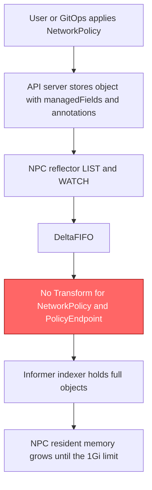
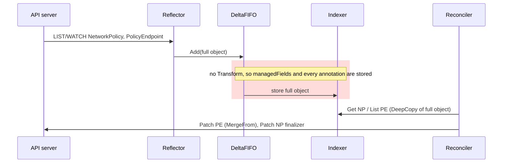
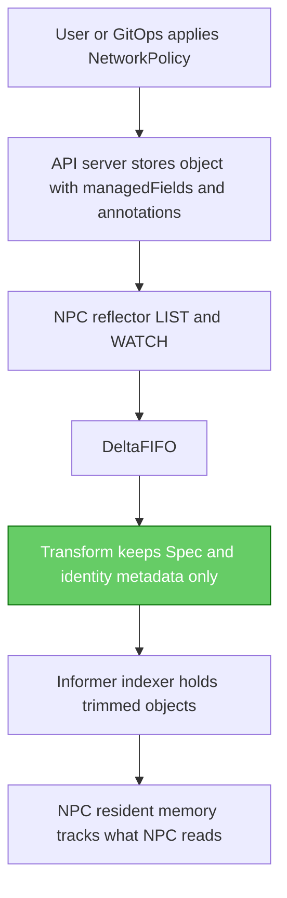
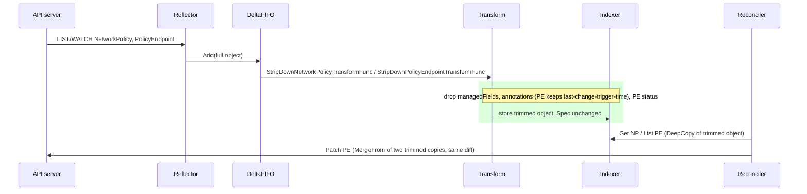

# NetworkPolicy and PolicyEndpoint cache footprint

## 1. Problem statement

The network policy controller (NPC) keeps every NetworkPolicy (NP) and every PolicyEndpoint (PE) in the cluster in memory, in its informer cache. It stores each object exactly as the API server sends it, including bookkeeping that NPC never reads: `metadata.managedFields` (the server-side record of which client wrote which field) and every annotation. For an NP created with `kubectl apply`, the annotations include `kubectl.kubernetes.io/last-applied-configuration`, a second JSON copy of the policy. In one large cluster (20,000 NetworkPolicies, 92% of them with an empty spec) NPC ran with a fixed 1Gi memory limit and was OOM-killed 11 times. Pods and Services are already trimmed before caching; NetworkPolicy and PolicyEndpoint are not.

Measured with this change (heap retained per decoded object, `Test_transformFootprint`):

| object | before | after | saved |
|---|---|---|---|
| NetworkPolicy created with `kubectl apply`, NPC finalizer added | 4,069 B | 2,846 B | 1,223 B (30%) |
| empty PolicyEndpoint | 2,626 B | 2,160 B | 466 B (18%) |
| PolicyEndpoint, 100 rules / 100 pods | 36,676 B | 36,176 B | 500 B (1.4%) |
| PolicyEndpoint, 1,000 rules / 1,000 pods | 284,349 B | 284,017 B | 332 B (0.1%) |

At 20k policies (one NP plus one mostly empty PE each), this projects to roughly 33 MiB saved. An earlier model estimated 410 MiB (736 → 326 MiB). The measured per-object savings do not support that model, so the real figure needs a heap profile on a large cluster (see section 7).

## 2. Root cause

(a) Cause and effect:

```
user / GitOps applies NP
  -> API server stores NP + last-applied annotation + managedFields
  -> NPC reflector LISTs/WATCHes NP and PE
  -> cache.ByObject{NP: {}, PE: {}} has no Transform        <-- faulty step
  -> full object (annotations + managedFields + Spec) kept in the indexer
  -> resident memory grows with policy count, not with what NPC uses
  -> fixed 1Gi limit reached at large policy counts -> OOM kill -> restart -> full relist
```

(b) Components (the faulty step is highlighted):



## 3. Current behaviour



```
API server            Reflector/DeltaFIFO                 Indexer                 Reconciler
    |  LIST/WATCH  -->        |                               |                        |
    |                         | queueActionLocked (no         |                        |
    |                         | transform for NP/PE)  ------> | store full NP/PE       |
    |                         |                               |  <--- Get/List --------| policy_controller.go:149 Get NP
    |                         |                               |                        | manager.go:110 List PE (MatchingFields)
    |                         |                               |                        | manager.go:136 Get oldRes
    |  <------------------------------------------------------------- Patch MergeFrom -| manager.go:146
    |  <------------------------------------------------- Patch finalizer (opt. lock) -| finalizer.go:49
```

The cache options come from `BuildCacheOptions`, `pkg/config/runtime_config.go:125`: NetworkPolicy and PolicyEndpoint are registered with empty `cache.ByObject{}`.

## 4. Proposed behaviour





```
BEFORE                                            | AFTER
DeltaFIFO ----------------------------> Indexer   | DeltaFIFO --> Transform -------------> Indexer
NP:  ObjectMeta (all, incl. managedFields,        | NP:  ObjectMeta keep-list, no annotations,
     last-applied annotation) + Spec              |      no managedFields, Spec verbatim
PE:  ObjectMeta (all, incl. managedFields)        | PE:  ObjectMeta keep-list, one annotation
     + Spec + Status                              |      (last-change-trigger-time), Spec verbatim
PE update: Patch(MergeFrom(cached full PE))       | PE update: Patch(MergeFrom(cached trimmed PE));
                                                  |   the diff is identical (spec + trigger time)
```

| what exists today | what changes | what stays |
|---|---|---|
| `ByObject` entries for NP and PE with no options | `Transform: k8s.StripDownNetworkPolicyTransformFunc` and `k8s.StripDownPolicyEndpointTransformFunc` (`pkg/k8s/policy_transform.go`) | Pod and Service transforms, the Pod field selector, ANP, CNP and CPE entries |
| full ObjectMeta | kept: Name, GenerateName, Namespace, UID, ResourceVersion, Generation, CreationTimestamp, DeletionTimestamp, DeletionGracePeriodSeconds, Labels, OwnerReferences, Finalizers. Dropped: managedFields, annotations (PE keeps `networking.k8s.aws/last-change-trigger-time`) | Spec of both types, unchanged |
| PE Status (an empty struct) | zeroed | nothing reads it |
| trigger-time key defined in `pkg/policyendpoints` | defined once as `k8s.LastChangeTriggerTimeAnnotation`; `policyendpoints` aliases it | key and value |

Fields NPC reads, and why each is kept:

- Spec: rule resolution, bin-packing and `EqualPolicyEndpointSpec`.
- DeletionTimestamp: chooses cleanup over reconcile.
- Finalizers: `HasFinalizer` and the new-policy metric.
- ResourceVersion: the update-event filter and the optimistic-lock finalizer patch.
- Labels: the PE Cleanup label selector.
- Name, Namespace, UID: identity and owner references.

## 5. Why this fix and not the alternatives

| alternative | why it was rejected |
|---|---|
| Drop only `managedFields` (denylist) | It keeps `last-applied-configuration`, the largest field on an applied NP, and it would let any new annotation back into the cache. |
| Copy Spec field by field | It would silently drop Spec fields added later and could change the `EqualPolicyEndpointSpec` result. Spec is kept verbatim instead. |
| Also trim ClusterPolicyEndpoint, ANP and CNP | CPE is written with `Update` from a cached object (`pkg/policyendpoints/manager.go:798`), so trimming it would delete annotations and labels on the server. That needs `Update` changed to `Patch` first; it is a follow-up. |
| Use a metadata-only informer | NPC needs Spec for every NP and PE, so it would have to Get every object from the API server: more API traffic for no memory gain. |
| Raise the 1Gi limit | Treats the symptom only; it is useful headroom until a fix lands. |
| Watch only the PEs NPC owns (selector) | NPC owns every PE, so this filters nothing. The PE size is dominated by Spec, which the controller needs. |

## 6. Edge cases

| # | case | verdict |
|---|---|---|
| 1 | Field read by the finalizer path | handled by the keep-list; covered by `Test_StripDownNetworkPolicyTransformFunc`, `Test_finalizerPatch_onStrippedNetworkPolicy` |
| 2 | Owner references | handled by the keep-list; covered by `Test_StripDownPolicyEndpointTransformFunc`, `Test_BuildCacheOptions_informerHoldsStrippedObjects` |
| 3 | `EqualPolicyEndpointSpec` invariance | Spec untouched; covered by `Test_StripDownPolicyEndpointTransformFunc` |
| 4 | Status writer | out of scope: NPC writes no NP or PE status |
| 5 | Leader change between read and write | diff-based patch; covered by `Test_updatePatch_fromStrippedCache`, `Test_finalizerPatch_onStrippedNetworkPolicy` |
| 6 | PE chunking across more than 1000 endpoints | covered by `Test_computePolicyEndpoints_sameOnStrippedCache` |
| 7 | Empty PE | covered by `Test_StripDownPolicyEndpointTransformFunc` |
| 8 | PE update that changes nothing | the `EqualPolicyEndpointSpec` short-circuit; covered by the invariance test |
| 9 | NP with no annotations or managedFields | covered by `Test_StripDownNetworkPolicyTransformFunc` |
| 10 | Deny-all NP (empty spec) | covered by `Test_StripDownNetworkPolicyTransformFunc` |
| 11 | NP being deleted | DeletionTimestamp and grace period kept; covered by `Test_StripDownNetworkPolicyTransformFunc` |
| 12 | PE without the trigger-time annotation | covered by `Test_StripDownPolicyEndpointTransformFunc` |
| 13 | Tombstones and other types | pass-through; covered by `Test_StripDownTransforms_passThroughOtherTypes` |
| 14 | Transform applied again on resync | idempotent; covered by both transform tests |
| 15 | Field index `spec.policyRef.name` | covered by `Test_BuildCacheOptions_informerHoldsStrippedObjects` |
| 16 | Label selector on PE (Cleanup) | covered by `Test_BuildCacheOptions_informerHoldsStrippedObjects` |
| 17 | CPE `Update` | out of scope: CPE untrimmed, pinned by `Test_buildCacheOptions_transforms` |
| 18 | ANP / CNP | out of scope (follow-up) |
| 19 | Annotation-only NP update | already skipped by the update filter; behaviour unchanged |
| 20 | Wiring regression | covered by `Test_buildCacheOptions_transforms` |
| 21 | Relist storm transient peak | out of scope: the LIST body is decoded in full before the Transform runs |
| 22 | Dual-stack, hostNetwork, identity collision | out of scope: all in Spec, untouched |
| 23 | Metric cardinality | no new metric |
| 24 | NPA data-plane races | out of scope: NPC output is unchanged |
| 25 | Requeue/backoff | the Transform never returns an error |
| 26 | Saving smaller than modelled | measured and reported (`Test_transformFootprint`) |

## 7. Proof plan

Unit tests, all in this branch:

- `pkg/k8s`: `Test_StripDownNetworkPolicyTransformFunc`, `Test_StripDownPolicyEndpointTransformFunc`, `Test_StripDownTransforms_passThroughOtherTypes`, `Test_finalizerPatch_onStrippedNetworkPolicy`, `Test_transformFootprint`
- `pkg/policyendpoints`: `Test_computePolicyEndpoints_sameOnStrippedCache`, `Test_updatePatch_fromStrippedCache`
- `pkg/config`: `Test_buildCacheOptions_transforms`, `Test_BuildCacheOptions_informerHoldsStrippedObjects` (a real controller-runtime cache against a fake API server)
- Mutation check: 13 of 13 mutants killed, including removing each Transform.

In-cluster before/after. The control-plane NPC's memory cannot be observed directly, so the plan is to run NPC in the data plane with leader election off against a test cluster holding 20k NetworkPolicies (92% empty), then compare `/proc` RSS and a heap profile.

| metric | before | after |
|---|---|---|
| NPC RSS, 20k NP (92% empty) | modelled 736 MiB; incident: OOM at the 1Gi limit | pending CLUSTER_OK |
| heap in use, NP + PE informers | modelled 352 MiB (PE) | pending CLUSTER_OK |
| bytes per cached NP (measured, unit) | 4,069 B | 2,846 B |
| bytes per cached empty PE (measured, unit) | 2,626 B | 2,160 B |

Caveat: a data-plane copy shows the direction of the change only. The real control-plane NPC may see different managedFields (more field managers) and different spec sizes.

## 8. Operability

- Metrics and logs: none added or changed.
- Visible difference: objects read from NPC's cache (debug dumps, a heap profile) no longer carry managedFields or annotations. Objects on the API server are unchanged, because every write NPC makes from a cached NP or PE is a merge patch whose diff holds only the fields NPC changes.
- Rollback: revert the two `Transform:` lines in `pkg/config/runtime_config.go`. Nothing is persisted, so a restart rebuilds the full cache.
- Strict vs standard mode: no effect. Those are agent (NPA) enforcement modes, and the PolicyEndpoint Spec NPC writes is unchanged.
- Future readers: a new read of an NP or PE metadata field must be added to `stripObjectMeta` in `pkg/k8s/policy_transform.go`. Annotations are dropped by design.
